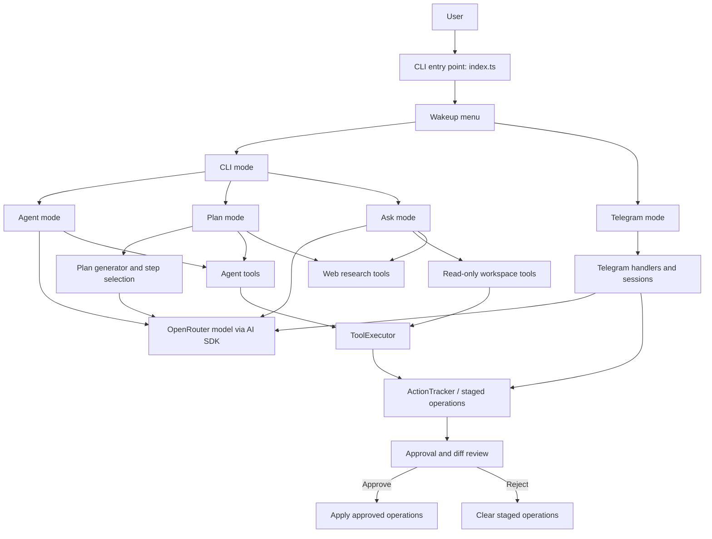

# AgentForge — AI Coding Agent

AgentForge is a terminal-first AI coding assistant built with **TypeScript**, **Bun**, and the **Vercel AI SDK**. It combines interactive coding workflows with LLM-powered tool use, staged file changes, and approval-based review. A Telegram mode is also included for interacting with the agent through a bot.

> **Project status:** Personal/experimental project. Review the code and test it in a disposable repository before using it on important files. Some operations depend on external API keys and provider availability.

## Features

- **Agent mode** — use an LLM-powered agent with workspace tools and a review flow for proposed changes.
- **Plan mode** — turn a goal into steps, select which steps to run, and review staged operations before applying them.
- **Ask mode** — ask questions through an interactive terminal workflow.
- **Diff-based review** — inspect staged changes and approve or reject operations before they are applied.
- **CLI interface** — choose a workflow from an interactive terminal menu.
- **Telegram integration** — optional bot-based interaction, including approval/session workflows.
- **OpenRouter support** — select the model through environment configuration.
- **Optional web research tools** — Firecrawl integration is used by the project's web-tooling code.

## Architecture & workflow

AgentForge uses a terminal-first entry point and routes the user into one of three workflows. The CLI workflows share the configured OpenRouter model and reuse the agent tool/execution layer where appropriate. Telegram is an alternative interaction surface with its own handlers and approval sessions.

### High-level architecture



### Workflow details

1. **Startup:** Run `bun run index.ts wakeup`. The wakeup menu lets you choose CLI or Telegram mode.
2. **Agent mode:** Enter a goal. The model can call workspace tools through the agent tool layer. File mutations are staged, shown for review, and applied only after the approval flow accepts them.
3. **Plan mode:** Enter a goal, generate a plan, select steps, and confirm execution. Selected steps use agent and web-research tools; staged operations then go through approval and review.
4. **Ask mode:** Ask a question. The workflow provides read-oriented workspace tools and web-research tools. It can optionally save the answer as a Markdown file; file creation is staged for approval, while file modification and shell execution are disabled in this mode's configuration.
5. **Telegram mode:** Start the optional bot integration to interact through Telegram. Bot handlers and session modules manage agent/plan interactions and approval steps. Telegram requires its own credentials and network access.

### Main code areas

| Path | Responsibility |
|---|---|
| `index.ts` | CLI command entry point and `wakeup` command |
| `tui/wakeup.ts` | Startup menu and mode selection |
| `modes/cli.ts` | Routes to Agent, Plan, and Ask modes |
| `modes/agent/` | Agent orchestration, tools, execution, action tracking, diffs, and approvals |
| `modes/plan/` | Plan generation, step selection, execution, and web tools |
| `modes/ask/` | Question-answer workflow and read-oriented tools |
| `modes/telegram/` | Telegram bot handlers, agent runs, and approval/session management |
| `ai/ai.config.ts` | Creates the configured OpenRouter model provider |
| `tui/terminal-md.ts` | Renders Markdown output in the terminal |

> **Safety note:** Approval gates reduce accidental changes but are not a substitute for backups or sandboxing. Test in a disposable repository first, inspect every proposed diff, and never run the agent against important files without a recoverable backup.

## Tech stack

- TypeScript
- Bun
- Vercel AI SDK (`ai`)
- OpenRouter AI SDK provider
- Commander and Clack for the CLI
- Telegraf for Telegram integration
- Firecrawl for web research tools

## Requirements

- [Bun](https://bun.sh/) installed
- An [OpenRouter API key](https://openrouter.ai/) and a model ID supported by your account
- Optional: a Telegram bot token and Telegram owner ID if you want to use Telegram mode
- Optional: a Firecrawl API key for web research features

## Getting started

### 1. Clone the repository

```bash
git clone https://github.com/YOUR_USERNAME/agentforge-ai-coding-agent.git
cd agentforge-ai-coding-agent
```

Replace `YOUR_USERNAME` with your GitHub username.

### 2. Install dependencies

```bash
bun install
```

### 3. Configure environment variables

Create a `.env` file in the project root. Bun loads environment variables from `.env` files automatically.

```dotenv
OPENROUTER_API_KEY=your_openrouter_api_key
OPENROUTER_DEFAULT_MODEL=your_openrouter_model_id

# Optional: needed for Telegram mode
TELEGRAM_BOT_TOKEN=your_telegram_bot_token
TELEGRAM_OWNER_ID=your_telegram_numeric_user_id

# Optional: used by web research tools
FIRECRAWL_API_KEY=your_firecrawl_api_key

# Optional: additional skill directories, if configured by your setup
SKILLS_DIRS=
```

Do not commit `.env` or real API keys. Keep credentials private and rotate any key that is accidentally exposed.

### 4. Start AgentForge

```bash
bun run index.ts wakeup
```

Choose **CLI** to open the Agent, Plan, and Ask workflows, or choose **Telegram** to start the bot integration.

## Configuration

| Variable | Required | Purpose |
|---|---|---|
| `OPENROUTER_API_KEY` | Yes for LLM workflows | Authenticates requests to OpenRouter |
| `OPENROUTER_DEFAULT_MODEL` | Yes for LLM workflows | Model ID used by the agent |
| `TELEGRAM_BOT_TOKEN` | Telegram mode | Token created through Telegram's BotFather |
| `TELEGRAM_OWNER_ID` | Telegram mode | Telegram user ID used by the bot workflow |
| `FIRECRAWL_API_KEY` | For Firecrawl-backed web tools | Authenticates Firecrawl requests |
| `SKILLS_DIRS` | Optional | Additional skill directories, where supported |

## Safety notes

- Run the project in a test repository or sandbox first.
- Inspect proposed file changes before approving them.
- Commit or back up important work before running an agent workflow.
- Never paste API keys into source code or publish them in issues, logs, screenshots, or commits.
- Review tool permissions and external API costs before use.

## Current limitations

- Model quality, latency, and cost depend on the selected provider and model.
- Telegram mode requires valid Telegram configuration and network access.
- Web research features require the relevant external service configuration.
- This repository is under active development; commands and behavior may change.

## Roadmap ideas

- Add automated tests for agent tools and approval flows.
- Improve error handling for missing configuration and provider failures.
- Add example workflows and safe demo fixtures.
- Add CI checks, release packaging, and clearer configuration validation.

## Contributing

Issues and pull requests are welcome. For changes involving file operations or tool execution, include a short explanation of the behavior and how it was tested.

## License

No license has been specified yet. Until a license is added, all rights remain with the copyright holder; do not assume the code is available for reuse under an open-source license.
